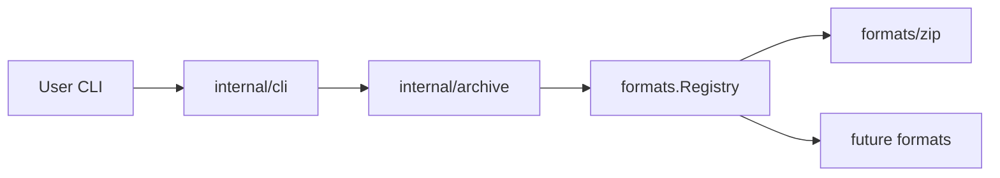

# zipstar

<p align="center">
  
</p>

<p align="center"><strong>zip and beyond</strong> · extensible archive / unarchive CLI</p>

<p align="center"><a href="docs/splash.html">Splash page</a></p>

Archive / unarchive CLI with an extensible format plugin system. v1 ships **zip** (including AES-256 passwords) on macOS.

## Docs

- [Splash](docs/splash.html) — project splash page
- [SPEC](docs/SPEC.md) — commands, flags, exit codes, behavior
- [ARCHITECTURE](docs/ARCHITECTURE.md) — packages, request flow, interactive paths
- [IMPLEMENTATION SPEC](docs/IMPLEMENTATION_SPEC.md) — wiring details and archive/unarchive walkthroughs
- [FORMATS](docs/FORMATS.md) — zip contract and limitations
- [Implementation notes](docs/implementation/) — feature writeups (picker, AES passwords, …)

## High-level architecture

zipstar separates **CLI parsing**, **path/format orchestration**, and **format backends** so new archive types plug in without rewriting commands.



| Layer | Role |
|-------|------|
| `cmd/zipstar` | Binary entrypoint: build registry, register formats, exit |
| `internal/cli` | Cobra commands, flags, masked passwords, picker, completion, exit codes |
| `internal/cli/picker` | Bubble Tea archive path picker (`unarchive` / `list`) |
| `internal/archive` | Infer/validate `--format` vs extension (plus content sniff) |
| `internal/detect` | Magic-byte sniff + on-disk sniff cache |
| `internal/formats` | `Format` interface + registry (the extensibility seam) |
| `internal/formats/zip` | Zip read/write (stdlib + AES via yeka) |

**Request path (archive):** flags → resolve format → build file entries → overwrite check → `Format.Archive(...)`.

**Request path (unarchive):** optional picker → resolve format (ext/sniff) → resolve password if needed → `Format.Unarchive(...)` → TTY success hint.

For a full walkthrough of these paths, see [IMPLEMENTATION_SPEC.md](docs/IMPLEMENTATION_SPEC.md) and [interactive-path-picker.md](docs/implementation/interactive-path-picker.md).

## Build

Requires Go 1.22+ (developed with Go 1.27).

```bash
go build -o zipstar ./cmd/zipstar
```

## Usage

```bash
# Archive a folder (writes project.zip)
./zipstar a ./project

# Archive with explicit output and compression level
./zipstar archive -o out.zip --level 9 ./project ./notes.txt

# Encrypt (-e); omit -p on a TTY to get a masked prompt: Password: ******
./zipstar a -e -o secret.zip ./project

# Encrypt with explicit password (visible on the command line — prefer prompt/env)
./zipstar a -e -p 'secret' -o secret.zip ./project

# Extract to another directory
./zipstar u secret.zip -C /tmp/out

# Extract encrypted archive (TTY prompts Password: ****** if flag/env unset)
./zipstar u secret.zip -C /tmp/out

# Interactive extract/list (TTY): omit <archive> to open the path picker
./zipstar u -C /tmp/out
./zipstar l

# List
./zipstar l -v out.zip

# Shell completion (zsh example) — unarchive/list complete dirs + *.zip
./zipstar completion zsh > "${fpath[1]}/_zipstar"

# Full flags for a subcommand (root --help only shows globals)
./zipstar archive --help
```

Aliases: `a` = `archive`, `u` = `unarchive`, `l` = `list`.

| Shortcut | Long form | Notes |
|----------|-----------|--------|
| `-e` | `--encrypt` | Archive only; creates AES-256 zip |
| `-p` | `--password` | Password (or TTY masked prompt / `ZIPSTAR_PASSWORD`) |
| `-o` | `--output` | Archive output path |
| `-C` | `--dir` | Unarchive destination (default `.`) |
| `-v` | `--verbose` | Per-entry / extra list columns |

Password sources: `-p`/`--password` → `ZIPSTAR_PASSWORD` → interactive masked prompt (`*`) on a TTY.

Interactive path picker and success hints run only when stdin is a TTY. Scripts should pass `<archive>` and passwords via flag/env. Details: [interactive-path-picker](docs/implementation/interactive-path-picker.md), [zip-aes-passwords](docs/implementation/zip-aes-passwords.md).

## Test

```bash
go test ./...
```

## Layout

```
cmd/zipstar/           # binary entrypoint
internal/cli/          # cobra commands, masked password, completion, TTY hints
internal/cli/picker/   # Bubble Tea archive path picker
internal/archive/      # format resolve (ext + sniff) + path orchestration
internal/detect/       # content sniff + cache
internal/formats/      # Format interface + zip backend
docs/                  # SPEC / ARCHITECTURE / IMPLEMENTATION_SPEC / FORMATS / implementation
```

## Developer notes: adding a format

To add a new archive format (for example `tar.gz`):

1. **Implement the plugin** under `internal/formats/<name>/` with a type that satisfies `formats.Format`:

   ```go
   type Format interface {
       Name() string
       Extensions() []string // include the leading dot, e.g. ".zip"
       Archive(ctx context.Context, opts ArchiveOpts) error
       Unarchive(ctx context.Context, opts UnarchiveOpts) error
       List(ctx context.Context, opts ListOpts) ([]Entry, error)
   }
   ```

2. **Register it** in [`cmd/zipstar/main.go`](cmd/zipstar/main.go) next to zip:

   ```go
   reg := formats.NewRegistry()
   reg.Register(zipfmt.New())
   reg.Register(targz.New()) // new backend
   os.Exit(cli.Execute(reg))
   ```

3. **Honor shared contracts** already enforced by the CLI/orchestrator:
   - Archive member names come from `ArchiveOpts.Files` (base-name roots); do not reintroduce absolute paths or `..`.
   - Respect `Force` (refuse overwrite unless set).
   - On extract, guard against zip-slip / path escape from `DestDir`.
   - Treat `Password` as optional; never log it. If the format has no encryption, ignore an empty password and error clearly if a password is required but missing.
   - Map `--level` sensibly (or document limits in FORMATS.md the way zip does for AES).

4. **Compound extensions** — `filepath.Ext("file.tar.gz")` is `.gz`. If your format needs `.tar.gz`, teach `archive.ResolveFormat` (or a helper) about multi-part suffixes and cover it with tests in `internal/archive`.

5. **Document and test**
   - Add a section to [docs/FORMATS.md](docs/FORMATS.md).
   - Extend `internal/detect` sniffers when content-based detection is needed.
   - Table-driven tests beside the new package; extend resolve tests for the new extension / `--format` name.
   - Prefer not changing `internal/cli` unless you need format-specific flags.

You do **not** need new cobra subcommands for archive/unarchive/list: those already call the interface. Deep wiring and worked examples are in [docs/IMPLEMENTATION_SPEC.md](docs/IMPLEMENTATION_SPEC.md).
