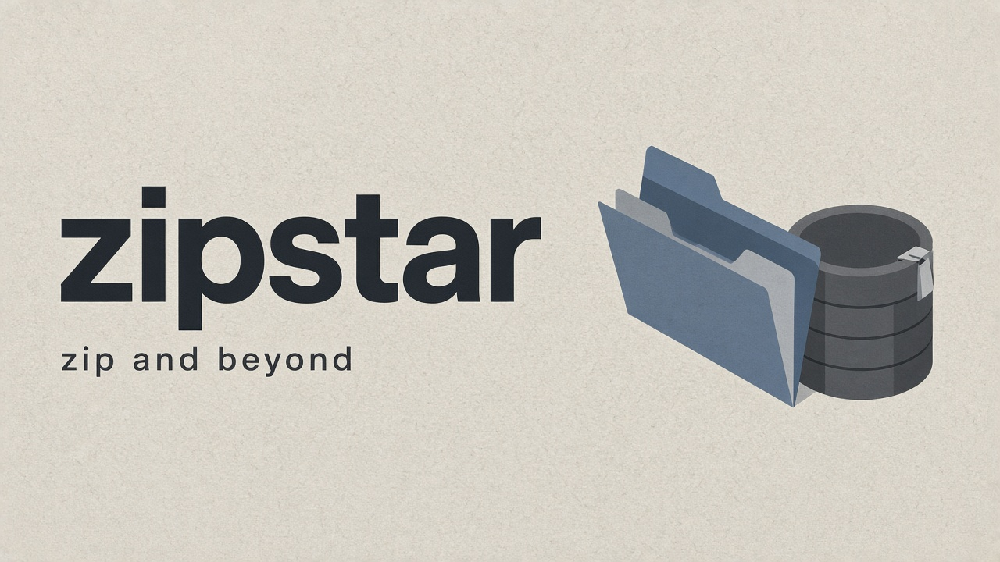
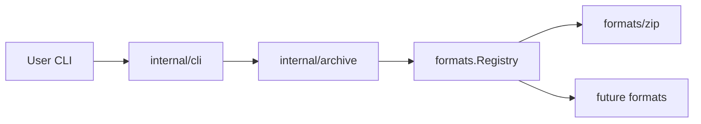

# zipstar

<p align="center">
  
</p>

<p align="center"><strong>zip and beyond</strong> · extensible archive / unarchive CLI</p>

<p align="center"><a href="docs/splash.html">Splash page</a></p>

Archive / unarchive CLI with an extensible format plugin system. v1 ships **zip** (including AES-256 passwords) on macOS.

## Docs

- [Splash](docs/splash.html) — project splash page
- [SPEC](docs/SPEC.md) — commands, flags, exit codes, behavior
- [ARCHITECTURE](docs/ARCHITECTURE.md) — package map and request flow
- [IMPLEMENTATION SPEC](docs/IMPLEMENTATION_SPEC.md) — wiring details and archive/unarchive walkthroughs
- [FORMATS](docs/FORMATS.md) — zip contract and limitations
- [Implementation notes](docs/implementation/) — per-feature writeups

## High-level architecture

zipstar separates **CLI parsing**, **path/format orchestration**, and **format backends** so new archive types plug in without rewriting commands.



| Layer | Role |
|-------|------|
| `cmd/zipstar` | Binary entrypoint: build registry, register formats, exit |
| `internal/cli` | Cobra commands (`archive`/`unarchive`/`list`), flags, passwords, exit codes |
| `internal/archive` | Infer/validate `--format` vs extension; map disk paths to archive names |
| `internal/formats` | `Format` interface + registry (the extensibility seam) |
| `internal/formats/zip` | Zip read/write (stdlib + AES via yeka) |

**Request path (archive):** flags → resolve format → build file entries → overwrite check → `Format.Archive(...)`.

**Request path (unarchive):** flags → resolve format → resolve password if needed → `Format.Unarchive(...)`.

For a full walkthrough of these paths, see [IMPLEMENTATION_SPEC.md](docs/IMPLEMENTATION_SPEC.md).

## Build

Requires Go 1.22+ (developed with Go 1.27).

```bash
go build -o zipstar ./cmd/zipstar
```

## Usage

```bash
# Archive a folder (writes project.zip)
./zipstar a ./project

# Archive with explicit output and compression level
./zipstar archive -o out.zip --level 9 ./project ./notes.txt

# Encrypt (short: -e / -p)
./zipstar a -e -p 'secret' -o secret.zip ./project

# Extract
./zipstar u -p 'secret' secret.zip -C /tmp/out

# List
./zipstar l -v out.zip

# Full flags for a subcommand (root --help only shows globals)
./zipstar archive --help
```

Aliases: `a` = `archive`, `u` = `unarchive`, `l` = `list`.

Password sources: `-p`/`--password`, then `ZIPSTAR_PASSWORD`, then interactive prompt.

## Test

```bash
go test ./...
```

## Layout

```
cmd/zipstar/           # binary entrypoint
internal/cli/          # cobra commands
internal/archive/      # format + path orchestration
internal/formats/      # Format interface + zip backend
docs/                  # SPEC / ARCHITECTURE / IMPLEMENTATION_SPEC / FORMATS
```

## Developer notes: adding a format

To add a new archive format (for example `tar.gz`):

1. **Implement the plugin** under `internal/formats/<name>/` with a type that satisfies `formats.Format`:

   ```go
   type Format interface {
       Name() string
       Extensions() []string // include the leading dot, e.g. ".zip"
       Archive(ctx context.Context, opts ArchiveOpts) error
       Unarchive(ctx context.Context, opts UnarchiveOpts) error
       List(ctx context.Context, opts ListOpts) ([]Entry, error)
   }
   ```

2. **Register it** in [`cmd/zipstar/main.go`](cmd/zipstar/main.go) next to zip:

   ```go
   reg := formats.NewRegistry()
   reg.Register(zipfmt.New())
   reg.Register(targz.New()) // new backend
   os.Exit(cli.Execute(reg))
   ```

3. **Honor shared contracts** already enforced by the CLI/orchestrator:
   - Archive member names come from `ArchiveOpts.Files` (base-name roots); do not reintroduce absolute paths or `..`.
   - Respect `Force` (refuse overwrite unless set).
   - On extract, guard against zip-slip / path escape from `DestDir`.
   - Treat `Password` as optional; never log it. If the format has no encryption, ignore an empty password and error clearly if a password is required but missing.
   - Map `--level` sensibly (or document limits in FORMATS.md the way zip does for AES).

4. **Compound extensions** — `filepath.Ext("file.tar.gz")` is `.gz`. If your format needs `.tar.gz`, teach `archive.ResolveFormat` (or a helper) about multi-part suffixes and cover it with tests in `internal/archive`.

5. **Document and test**
   - Add a section to [docs/FORMATS.md](docs/FORMATS.md).
   - Table-driven tests beside the new package; extend resolve tests for the new extension / `--format` name.
   - Prefer not changing `internal/cli` unless you need format-specific flags.

You do **not** need new cobra subcommands for archive/unarchive/list: those already call the interface. Deep wiring and worked examples are in [docs/IMPLEMENTATION_SPEC.md](docs/IMPLEMENTATION_SPEC.md).
