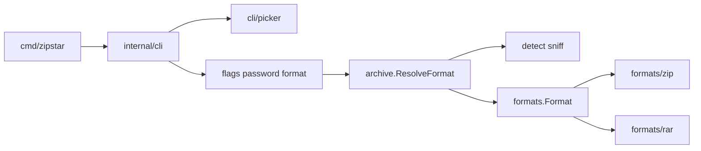
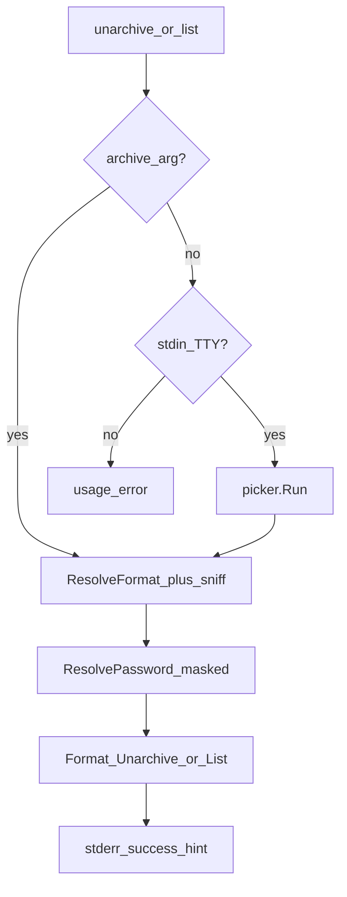

# zipstar ARCHITECTURE (v1)

How a request flows through the code, and how to add a new archive format.

For detailed wiring and step-by-step archive/unarchive use cases, see [IMPLEMENTATION_SPEC.md](IMPLEMENTATION_SPEC.md).

## Package map

```
cmd/zipstar/              # main: build registry, register formats, exit
internal/cli/             # cobra commands, flags, password, progress, TTY hints, completion
internal/cli/picker/      # Bubble Tea archive path picker (unarchive/list)
internal/archive/         # format resolution (ext + sniff), globs, multi-volume coalescing, path → entries
internal/detect/          # content sniff + on-disk sniff cache
internal/formats/         # Format interface + Registry
internal/formats/zip/     # zip implementation (stdlib + yeka for AES)
internal/formats/rar/     # rar extract/list (UnRAR CLI preferred, rardecode fallback; create unsupported)
```

| Package / file | Responsibility |
|----------------|----------------|
| `internal/cli/root.go` | Command tree, persistent flags (`--format`, `-v`, `--force`), exit mapping |
| `internal/cli/archive.go` | `archive` / `a`; `-e/--encrypt`, `-o`, `--level`, password |
| `internal/cli/unarchive.go` | `unarchive` / `u`; optional `<archive>`, `-C`, completion |
| `internal/cli/list.go` | `list` / `l`; optional `<archive>`, completion |
| `internal/cli/archive_arg.go` | Resolve archive arg or launch picker on TTY |
| `internal/cli/password.go` | Flag → env → masked `*` TTY prompt |
| `internal/cli/complete.go` | Shell completion for archive paths (dirs + registered exts) |
| `internal/cli/hint.go` / `tty.go` | TTY success hints; stdin TTY detection |
| `internal/cli/picker/` | Interactive browser + typeahead path picker |
| `internal/archive/resolve.go` | Extension inference + content sniff fallback |
| `internal/detect/` | Zip magic sniff + `$XDG_CACHE_HOME/zipstar/sniff.json` cache |
| `internal/formats/` | `Format` interface + registry (name + extension lookup) |

## Request flow



1. **`main`** constructs a `formats.Registry`, registers `zip` and `rar`, calls `cli.Execute`.
2. **`cli`** parses cobra flags; for `unarchive`/`list` without `<archive>` on a TTY, runs the path picker; `unarchive` expands globs and coalesces multi-volume RAR sets; resolves password if needed; maps errors to exit codes `1` / `2`.
3. **`archive.ResolveFormat`** applies SPEC inference / mismatch rules, with content sniff when the extension is missing or unknown.
4. **`archive.BuildEntries`** turns user paths into `formats.FileEntry` values (base-name roots).
5. The concrete **`Format`** performs I/O.
6. On TTY success for unarchive/list, **`cli`** prints a one-line stderr hint.

### Interactive / human paths (TTY only)



`archive -e/--encrypt` without `--password` / `ZIPSTAR_PASSWORD` also hits the masked password prompt on a TTY.

## Extensibility seam

```go
type Format interface {
    Name() string
    Extensions() []string
    Archive(ctx context.Context, opts ArchiveOpts) error
    Unarchive(ctx context.Context, opts UnarchiveOpts) error
    List(ctx context.Context, opts ListOpts) ([]Entry, error)
}
```

### Adding a format (e.g. tar.gz)

1. Create `internal/formats/targz` implementing `formats.Format`.
2. In `cmd/zipstar/main.go`, `reg.Register(targz.New())`.
3. Extend `internal/detect` with magic-byte recognition for the new format when needed.
4. Document extensions and behavior in `docs/FORMATS.md`.
5. Add table-driven tests beside the package.

No cobra command changes are required beyond optional format-specific flags later. Picker highlighting and shell completion pick up new extensions from the registry automatically.

Registered today: **zip** (full) and **rar** (extract/list).

## Password handling

Lives in `internal/cli` so formats only receive a resolved password string (or empty). Formats must not log passwords.

Precedence: `--password` → `ZIPSTAR_PASSWORD` → interactive prompt (TTY).

The interactive prompt uses raw terminal mode and masks each typed rune as `*` (backspace supported). Used by:

- `archive -e` / `--encrypt` when no flag/env password is set
- `unarchive` when the archive looks encrypted and no flag/env password is set

See [implementation/zip-aes-passwords.md](implementation/zip-aes-passwords.md).

## Interactive picker

See [implementation/interactive-path-picker.md](implementation/interactive-path-picker.md). Summary:

- TTY-only; missing `<archive>` on `unarchive` / `list`
- Browser + typeahead; cwd listing only (drill into dirs; future: depth ≤ 2)
- Esc cancels → exit `1`
- Injectable via `ArchivePicker` for tests

## Shell completion

Cobra `completion` subcommand plus `ValidArgsFunction` on `unarchive` / `list` (directories + registered extensions such as `.zip`). `archive` uses default shell file completion.

## Testing strategy

- Table-driven unit tests next to packages (`*_test.go`).
- Temp dirs via `t.TempDir()` for filesystem round-trips.
- Format inference / mismatch / sniff tests in `internal/archive` and `internal/detect`.
- Zip round-trip, symlink, overwrite, encrypt/decrypt in `internal/formats/zip`.
- RAR extract/list fixtures in `internal/formats/rar`.
- Password precedence, masked reader, picker/completion wiring, progress bar in `internal/cli`.

Run: `go test ./...`

## Go layout notes (for newcomers)

- **`internal/`** — importable only by this module (encapsulation).
- **`cmd/zipstar`** — the binary; keep it thin.
- Interfaces in `formats` avoid circular imports between CLI and backends.
