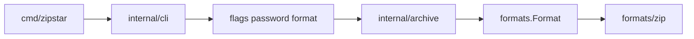

# zipstar ARCHITECTURE (v1)

How a request flows through the code, and how to add a new archive format.

For detailed wiring and step-by-step archive/unarchive use cases, see [IMPLEMENTATION_SPEC.md](IMPLEMENTATION_SPEC.md).

## Package map

```
cmd/zipstar/          # main: build registry, register formats, exit
internal/cli/         # cobra commands, flags, password resolution, exit codes
internal/archive/     # format resolution, path → archive entry mapping, overwrite checks
internal/formats/     # Format interface + Registry
internal/formats/zip/ # zip implementation (stdlib + yeka for AES)
```

## Request flow



1. **`main`** constructs a `formats.Registry`, registers `zip`, calls `cli.Execute`.
2. **`cli`** parses cobra flags, resolves password if needed, maps errors to exit codes `1` / `2`.
3. **`archive.ResolveFormat`** applies SPEC inference / mismatch rules.
4. **`archive.BuildEntries`** turns user paths into `formats.FileEntry` values (base-name roots).
5. The concrete **`Format`** performs I/O.

## Extensibility seam

```go
type Format interface {
    Name() string
    Extensions() []string
    Archive(ctx context.Context, opts ArchiveOpts) error
    Unarchive(ctx context.Context, opts UnarchiveOpts) error
    List(ctx context.Context, opts ListOpts) ([]Entry, error)
}
```

### Adding a format (e.g. tar.gz)

1. Create `internal/formats/targz` implementing `formats.Format`.
2. In `cmd/zipstar/main.go`, `reg.Register(targz.New())`.
3. Document extensions and behavior in `docs/FORMATS.md`.
4. Add table-driven tests beside the package.

No cobra command changes are required beyond optional format-specific flags later.

## Password handling

Lives in `internal/cli` so formats only receive a resolved password string (or empty). Formats must not log passwords.

## Testing strategy

- Table-driven unit tests next to packages (`*_test.go`).
- Temp dirs via `t.TempDir()` for filesystem round-trips.
- Format inference / mismatch tests in `internal/archive`.
- Zip round-trip, symlink, overwrite, encrypt/decrypt in `internal/formats/zip`.
- Password precedence in `internal/cli`.

Run: `go test ./...`

## Go layout notes (for newcomers)

- **`internal/`** — importable only by this module (encapsulation).
- **`cmd/zipstar`** — the binary; keep it thin.
- Interfaces in `formats` avoid circular imports between CLI and backends.
