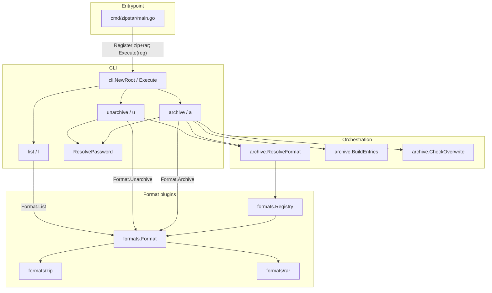

# zipstar Implementation Spec

How the code is wired, and how concrete archive / unarchive use cases move through the stack. For user-facing behavior see [SPEC.md](SPEC.md). For the short package map see [ARCHITECTURE.md](ARCHITECTURE.md).

## Wiring overview



### Startup (`cmd/zipstar/main.go`)

1. Create an empty `formats.Registry`.
2. Register each backend (`zipfmt.New()`, `rarfmt.New()`).
3. Hand the registry to `cli.Execute`, which builds the cobra tree and maps errors to exit codes `0` / `1` / `2`.

`main` is intentionally thin: **new formats are registered here**, not inside cobra command files.

### Layers and responsibilities

| Package | Owns | Does not own |
|---------|------|----------------|
| `internal/cli` | Flags, aliases, password precedence, exit-code wrapping, verbose callbacks | Bytes on disk / zip crypto |
| `internal/archive` | Format inference/mismatch, path → archive names, overwrite policy helpers | Concrete zip/tar/rar I/O |
| `internal/formats` | `Format` interface, `Registry`, option structs, `ErrArchiveNotSupported` | CLI flag names |
| `internal/formats/zip` | Reading/writing `.zip`, AES via yeka, deflate levels for plain zips | Password prompting |
| `internal/formats/rar` | RAR extract/list via rardecode; create returns `ErrArchiveNotSupported` | Password prompting |

Formats only ever see a resolved password string (or empty). They must not log it.

---

## Use case: archive a folder

Command:

```bash
zipstar a ./project
```

### Step-by-step

1. **Cobra** routes to `runArchive` with inputs `["./project"]`, default `--level 5`, no `-o`.
2. **Derive output path** — because `-o` is omitted, CLI picks format `zip` (or `--format` if set), then:

   ```text
   DeriveOutputName("./project", zip) → "project.zip"
   ```

3. **Resolve format** — `ResolveFormat(reg, "", "project.zip")` uses extension `.zip` → zip backend. If the user had passed `--format zip -o out.tar`, this step errors (mismatch).
4. **Password** — `--encrypt` is off → no password.
5. **Build entries** — `BuildEntries` `Lstat`s `./project`, walks the tree, and emits:

   ```text
   project/          (directory)
   project/a.txt
   project/empty/    (empty dir preserved)
   project/link.txt  (symlink stored as symlink, not followed)
   ```

   Archive names use each input’s **base name** as the root. Paths with `..` are rejected. Colliding base names across inputs error.
6. **Overwrite check** — if `project.zip` exists and `--force` is unset → exit `2` with a clear message.
7. **`Format.Archive`** (zip):
   - Unencrypted path uses stdlib `archive/zip` with a per-Writer flate compressor at `--level`.
   - Writes each `FileEntry` (dirs, files, symlink targets).
   - With `-v`, CLI’s `OnFile` prints each archive name as it is written.

### Encrypted variant

```bash
zipstar a -e -p secret -o secret.zip ./project
```

Same path through CLI until password resolution: flag `-p` wins over `ZIPSTAR_PASSWORD` / prompt. Zip backend switches to `yeka/zip`, sets AES-256 on file/symlink headers, and writes encrypted members. `--password` without `-e` is a usage error.

---

## Use case: unarchive

Command:

```bash
zipstar u project.zip -C /tmp/out
```

### Step-by-step

1. **Resolve format** from `project.zip` (or `--format`).
2. **Password**:
   - If `-p` or `ZIPSTAR_PASSWORD` is set → use it.
   - Else probe with `Format.List` (no password). If any entry is marked encrypted → prompt on a TTY.
3. **`Format.Unarchive`** opens the archive, iterates members:
   - Rejects zip-slip (`../`, absolute names escaping `-C`).
   - Creates directories; restores files with mode + modtime when available.
   - Restores symlinks via `os.Symlink` of the stored target.
   - Refuses to clobber existing paths unless `--force`.
4. Wrong AES password → runtime error (exit `2`) naming the entry; no need for `-v`.

### Encrypted extract

```bash
zipstar u -p secret secret.zip -C /tmp/out
```

Password is passed through `UnarchiveOpts.Password`; zip calls `SetPassword` on encrypted members before `Open()`.

---

## Use case: list

```bash
zipstar l -v secret.zip
```

Format is resolved from the path; zip lists headers **without** requiring a password. `-v` adds method and `plain|encrypted` columns. `-p` is optional for backends that may need it later.

---

## Format resolution rules (code contract)

Implemented in `internal/archive/resolve.go`:

| Situation | Result |
|-----------|--------|
| `--format zip`, path `out.zip` | OK → zip |
| No `--format`, path `out.zip` | OK → zip via extension |
| No `--format`, path `out` | Error: cannot infer |
| `--format zip`, path `out.tar` | Error: mismatch |
| Unknown `--format` | Error: lists registered names |

`--format` takes the **name** (`zip`), never the dotted extension (`.zip`).

---

## Adding a new archive format (summary)

See also the developer notes in the root [README](../README.md#developer-notes-adding-a-format). Checklist:

1. Implement `formats.Format` under `internal/formats/<name>/`.
2. `Extensions()` must include the leading dot (e.g. `.tar.gz` may need special handling if Go’s `filepath.Ext` only returns `.gz` — plan compound extensions in the resolver if you add such a format).
3. Register in `cmd/zipstar/main.go`.
4. Document in [FORMATS.md](FORMATS.md); add package tests and extend resolve tests for the new extension.
5. Honor `ArchiveOpts.Force`, path safety on extract, and never log passwords.

No changes to `archive` / `unarchive` / `list` command wiring are required for a format that fits the existing option structs.

---

## Related docs

- [SPEC.md](SPEC.md) — CLI behavior
- [ARCHITECTURE.md](ARCHITECTURE.md) — package map
- [FORMATS.md](FORMATS.md) — zip contract
- [implementation/](implementation/) — per-feature notes (passwords, list, archive-unarchive)
